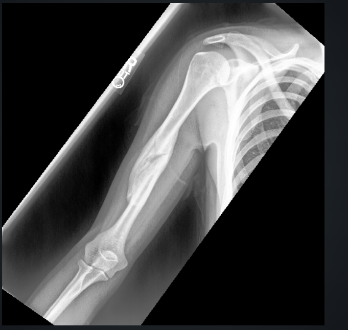
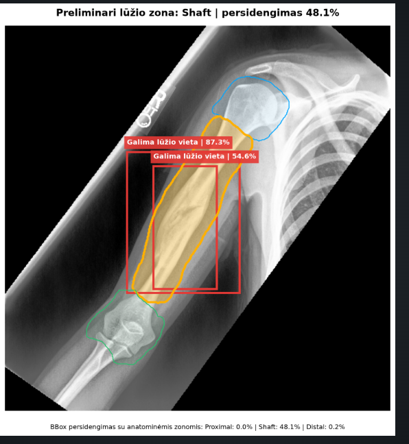

# Prompt 2 – „few-shot“ pavyzdys

„Few-shot“ atveju DI agentui pirmiausia pateikiami keli žinomi `(X,y)` pavyzdžiai. Po jų agentui pateikiama nauja rentgenograma, kurią reikia išanalizuoti.

## Žinomi pavyzdžiai

### Pavyzdys Nr. 1 – lūžio nėra

```json
{
  "X": "../data/examples/Negative/1/image1.png",
  "y": {
    "class": 0,
    "label": "lūžio nėra"
  }
}
```

### Pavyzdys Nr. 2 – lūžio nėra

```json
{
  "X": "../data/examples/Negative/2/image1.png",
  "y": {
    "class": 0,
    "label": "lūžio nėra"
  }
}
```

### Pavyzdys Nr. 3 – nustatytas lūžis

```json
{
  "X": "../data/examples/positive/1/image1.png",
  "y": {
    "class": 1,
    "label": "lūžis"
  }
}
```

### Pavyzdys Nr. 4 – nustatytas lūžis

```json
{
  "X": "../data/examples/positive/2/image1.png",
  "y": {
    "class": 1,
    "label": "lūžis"
  }
}
```

## Nauja įvestis X

Remdamasis pateiktais žinomais pavyzdžiais, išanalizuok šią naują rentgenogramą:



## Užklausa DI agentui

Atlik visą rentgenogramos analizę:

1. įvertink vaizdo kokybę;
2. nustatyk, ar rentgenogramoje yra lūžis;
3. pateik lūžio aptikimo pasitikėjimą;
4. aptikęs lūžį pažymėk jo vietą;
5. nustatyk preliminarią anatominę zoną;
6. pateik trumpą rezultato paaiškinimą.

Rezultatą `y` pateik JSON formatu.

## Gautas rezultatas y



```json
{
  "class": 1,
  "label": "lūžis",
  "fracture_detected": true,
  "predicted_zone": "shaft",
  "zone_overlap": 0.481,
  "detections": [
    {
      "label": "galima lūžio vieta",
      "confidence": 0.873
    },
    {
      "label": "galima lūžio vieta",
      "confidence": 0.546
    }
  ],
  "explanation": "Aptikta galima žastikaulio lūžio vieta. Didžiausias persidengimas nustatytas su žastikaulio kūno zona.",
  "recommendation": "Rezultatą turi patvirtinti gydytojas."
}
```

## Paaiškinimas

Skirtingai nuo „zero-shot“ metodo, šioje užklausoje agentas prieš naujos rentgenogramos analizę gauna keturis žinomus `(X,y)` pavyzdžius. Jie parodo agentui galimas klases ir laukiamą atsakymo formatą.
